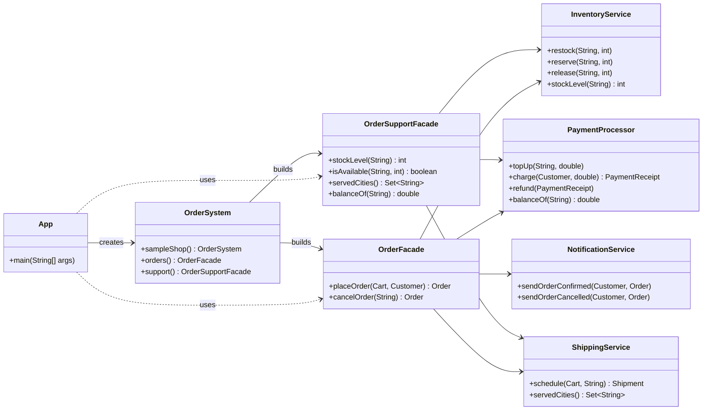

# Assignment #4 — Facade Pattern

**Course:** ShP-2216 Software Design Patterns
**Topic:** Option B — Online Order Processing Facade
**Stack:** Java 17 · Maven · JUnit 5

One `OrderFacade` hides a four-service subsystem — stock, payment, shipping and
notifications — behind two business methods, and gives back everything it already took
whenever a later step refuses.

---

## 1. Why this subsystem needs a facade

Placing an order is not one action, it is a pipeline of four steps that must run in a
fixed order:

```
reserve stock  →  charge the customer  →  book the shipment  →  notify the customer
```

Every step can refuse (not enough units, declined card, no carrier for the city), and
every refusal must undo the steps that already succeeded — otherwise the warehouse stays
short of units that nobody bought, or the customer pays for an order that never ships.
A client that orchestrates those four services itself would have to know their order,
their APIs, four different exception types and the whole rollback logic.

With the facade the client writes this:

```java
Order order = orders.placeOrder(cart, DemoShop.ALICE);   // that is all
```

…and the facade decides that stock is reserved before the card is charged, that the
shipment is booked before the e-mail goes out, and that a decline releases the units
again.

## 2. What the facade hides

| Hidden inside the subsystem | Exposed through the facade |
|---|---|
| `InventoryService`, `PaymentProcessor`, `ShippingService`, `NotificationService` | `OrderFacade`, `OrderSupportFacade` |
| `PaymentReceipt`, `Shipment`, `StockReservation` | `Order` (with its tracking number) |
| `OutOfStockException`, `PaymentDeclinedException`, `UnsupportedDestinationException` | `OrderRejectedException`, `OrderNotFoundException` |
| Carrier choice, delivery time, shipping fee, stock ledger, e-mail wording | `placeOrder(cart, customer)`, `cancelOrder(orderId)` |

## 3. Project structure

```
src/main/java/kz/aitu/sdp/order
├── App.java                 client: live demo, talks to the facades only
├── OrderSystem.java         composition root: builds the subsystem, hands out the facades
├── DemoShop.java            the products and customers of the demo
├── domain/                  Product, Customer, Cart, Order, OrderStatus
├── facade/                  OrderFacade, OrderSupportFacade, order-level exceptions
└── subsystem/               InventoryService, PaymentProcessor, ShippingService,
                             NotificationService (+ their result types and exceptions)

src/test/java/kz/aitu/sdp/order
├── facade/OrderFacadeTest.java         9 tests: pipeline, rollback, cancellation
├── facade/OrderSupportFacadeTest.java  2 tests: the second facade shares the subsystem
├── subsystem/InventoryServiceTest.java 4 tests: the subsystem on its own
└── subsystem/ShippingServiceTest.java  3 tests: carrier and delay rules
```

## 4. Build and run

```bash
mvn test        # 18 tests
mvn exec:java   # runs the demo
mvn package     # target/assignment4-facade-pattern-1.0.0.jar, then: java -jar …
```

In IntelliJ IDEA: *File → Open* → pick the `pom.xml` (or the project folder) and run
`App`.

## 5. Demo output

`mvn exec:java` — the rollback is visible in the numbers:

```
=== 1. Place an order: one facade call instead of four subsystem steps ===
  cart total                 474,000.00 KZT
  parcel weight              2.4 kg
  laptops in stock before    5
  Alice balance before       1,000,000.00 KZT
[notification] To alice@example.com: Order ORD-1 is confirmed. Tracking number: TRK-1
  order                      ORD-1 / CONFIRMED
  tracking number            TRK-1
  laptops in stock after     4
  Alice balance after        526,000.00 KZT

=== 2. Payment declined: the facade gives the reserved stock back ===
  cart total                 130,000.00 KZT
  Bob balance                20,000.00 KZT
  monitors in stock before   3
  rejected                   ORD-2 was rejected: Insufficient funds for Bob: needed 130000.00, available 20000.00
  monitors in stock after    3
  Bob balance after          20,000.00 KZT

=== 3. Destination not served: the charge is refunded and the stock returned ===
  customer city              Semey
  Carol balance before       200,000.00 KZT
  keyboards in stock before  10
  rejected                   ORD-3 was rejected: No carrier serves Semey
  cause kept                 No carrier serves Semey
  keyboards in stock after   10
  Carol balance after        200,000.00 KZT

=== 4. Cancel the order of step 1: the pipeline runs backwards ===
  order                      ORD-1 / CONFIRMED
  laptops in stock           4
  Alice balance              526,000.00 KZT
[notification] To alice@example.com: Order ORD-1 was cancelled and the money refunded.
  after cancelOrder          ORD-1 / CANCELLED
  laptops in stock           5
  Alice balance              1,000,000.00 KZT

=== 5. Second facade: read-only questions, no order involved ===
  laptops in stock           5
  20 laptops available?      false
  cities served              [Aktobe, Almaty, Astana, Shymkent]
```

## 6. Design notes

* **One facade, two methods.** `placeOrder` and `cancelOrder` are the whole business API;
  everything else is a private helper.
* **Rollback on every failure path.** Reservations are remembered as they happen and given
  back in reverse order, and a charge that already went through is refunded before the
  order-level exception leaves the facade.
* **The subsystem does not know the facade exists.** No subsystem class references
  `OrderFacade`, and `InventoryServiceTest` proves a subsystem still works on its own.
* **A second facade for a different question.** `OrderSupportFacade` answers availability,
  delivery reach and balance questions without adding read-only noise to `OrderFacade`.
* **A composition root.** `OrderSystem` is the single place that instantiates the subsystem
  classes, so both facades share the same instances and the client never touches them.

The six Clean Code principles with annotated code excerpts are in [REPORT.md](REPORT.md).

## 7. UML



See [REPORT.md](REPORT.md) for the full diagram including the domain classes.
