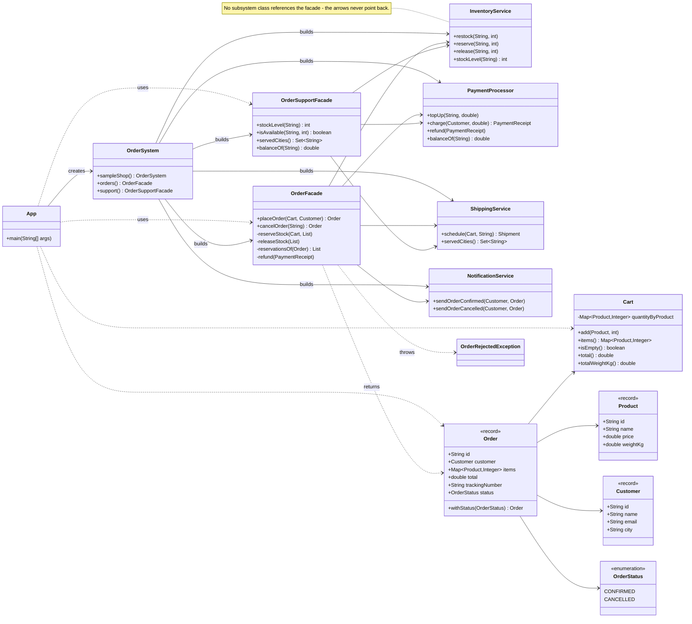

# Assignment #4 — Facade Pattern: Online Order Processing Facade

| | |
|---|---|
| **Course** | ShP-2216 — Software Design Patterns |
| **Student** | _[your full name]_, group _[your group]_ |
| **Topic** | Option B — Online Order Processing Facade |
| **Language / tools** | Java 17, Maven, JUnit 5, IntelliJ IDEA |
| **Repository** | https://github.com/CCE-Li/AITU-SDP-Assignment4 |

---

## 1. Introduction

### 1.1 The subsystem

An online shop cannot confirm an order on its own. Confirming one is a pipeline of four
collaborating services, and each of them owns real rules:

| Subsystem class | Responsibility | Rules it owns |
|---|---|---|
| `InventoryService` | the warehouse ledger | how many units exist, what "enough stock" means, how reservation and release change the ledger |
| `PaymentProcessor` | the bank gateway | the customer's balance, whether a charge is accepted, what a receipt is, how a refund works |
| `ShippingService` | delivery booking | which cities are served, which carrier takes a parcel of a given weight, how long the route takes, what it costs |
| `NotificationService` | customer communication | the wording of a confirmation or a cancellation |

They must run in a fixed order — **reserve → charge → ship → notify** — and every step
after the first one can refuse: the card may be declined, and no carrier may serve the
customer's city.

### 1.2 Why it needs a facade

Without a facade the client has to do all of this by hand:

* know the four services, their order and their individual APIs;
* hold and react to three different subsystem exceptions
  (`OutOfStockException`, `PaymentDeclinedException`, `UnsupportedDestinationException`);
* undo the steps that already succeeded — remember every reserved product and quantity so
  that a decline can release them again, and refund the charge when the shipment fails;
* keep track of previously placed orders to be able to cancel one later.

That is a lot of knowledge for a class that only wants to *sell something*. Worse, it is
knowledge that has to be repeated by every client — a web controller, a CLI, a test — and
any mistake in the rollback leaves the warehouse short of units nobody bought, or charges
a customer for an order that never ships.

### 1.3 What the facade offers instead

```java
Order order = orders.placeOrder(cart, DemoShop.ALICE);   // reserve → charge → ship → notify
Order cancelled = orders.cancelOrder(order.id());        // release → refund → notify
```

Two methods, one exception type per failure mode, and no subsystem class in sight. A
second, deliberately narrow facade (`OrderSupportFacade`) answers the read-only questions a
support desk asks — availability, delivery reach, balance — so that `OrderFacade` keeps
its single job.

---

## 2. UML class diagram



### 2.1 How a call flows

```
placeOrder(cart, customer)
 ├─ 1. reserveStock(cart, reservations)   InventoryService.reserve(...)   each success is remembered
 ├─ 2. payments.charge(customer, total)   PaymentProcessor.charge(...)    returns a PaymentReceipt
 ├─ 3. shipping.schedule(cart, city)      ShippingService.schedule(...)   returns a Shipment
 ├─ 4. notifications.sendOrderConfirmed() NotificationService             the last step
 └─ on any failure: releaseStock(reservations) + refund(receipt) + OrderRejectedException
```

| Failure at | What the facade undoes |
|---|---|
| step 1 — not enough stock | releases the units already reserved for the earlier cart lines; nothing was charged |
| step 2 — card declined | releases all reserved units; no money moved |
| step 3 — city not served | refunds the charge made in step 2 **and** releases all reserved units |
| step 4 | cannot fail in this simulation; if it could, the same rollback would run |

A rejected order leaves no trace: it is not registered, so `cancelOrder` on it reports
`OrderNotFoundException` (asserted by `OrderFacadeTest.rejectedOrderIsNeverRegistered`).

---

## 3. Clean Code principles

Six principles are used in the project; each one shows the excerpt it applies to and what
the code would look like without it.

### 4.1 Meaningful, self-explanatory names

The public API reads like the business sentence it performs, so no documentation is needed
to call it.

```java
public Order placeOrder(Cart cart, Customer customer) throws OrderRejectedException
public Order cancelOrder(String orderId) throws OrderNotFoundException
```

The same holds inside the subsystem: `reserve` / `release` / `restock` / `stockLevel` say
exactly which direction the units move, and `charge` / `refund` / `topUp` which direction
the money moves.

**Without it** — the same two methods, named after nothing in particular:

```java
public Order process(Data d, int c) throws Exception   // what is d, what is c, what does it do?
public void update(String id, int q)                   // add units or take them away?
```

### 4.2 Single Responsibility: the facade coordinates, it does not reimplement

`OrderFacade` sequences four calls and knows nothing about carrier pricing, stock rules or
e-mail wording. All of that stays in the service that owns it.

```java
try {
    reserveStock(cart, reservations);
    receipt = payments.charge(customer, cart.total());
    Shipment shipment = shipping.schedule(cart, customer.city());

    Order order = new Order(orderId, customer, cart.items(), cart.total(),
            shipment.trackingNumber(), OrderStatus.CONFIRMED);
    ordersById.put(orderId, order);
    receiptsByOrderId.put(orderId, receipt);
    notifications.sendOrderConfirmed(customer, order);

    return order;
}
```

**Without it** — a facade that also does the work of its subsystem:

```java
public Order placeOrder(Cart cart, Customer customer) {
    for (var line : cart.items().entrySet()) {
        int left = stock.get(line.getKey().id());            // stock rules inside the facade
        if (left < line.getValue()) throw new RuntimeException("no stock");
        stock.put(line.getKey().id(), left - line.getValue());
    }
    if (balance < cart.total()) throw new RuntimeException("no money");  // payment rules too
    balance -= cart.total();
    String carrier = totalWeight <= 5 ? "KazPost" : "DHL";   // and shipping rules…
    // …and the e-mail text, and the rollback, all in one 120-line method
}
```

That version cannot be reused, tested in isolation, or changed without touching the
facade. In this project the carrier rule lives in `ShippingService` (and is tested by
`ShippingServiceTest`), and the facade stays a coordinator.

### 4.3 No subsystem details leak through the public interface

The facade's surface mentions only domain types. `PaymentReceipt`, `Shipment`,
`StockReservation` and the three subsystem exceptions never appear in a public signature —
three subsystem failures are translated into one order-level exception.

```java
} catch (OutOfStockException | PaymentDeclinedException | UnsupportedDestinationException failure) {
    releaseStock(reservations);
    refund(receipt);
    throw new OrderRejectedException(orderId + " was rejected: " + failure.getMessage(), failure);
}
```

The shipment is reduced to the one field the client cares about (`trackingNumber`) before
it is put into the `Order`, and the receipt is kept privately so that `cancelOrder` can
refund with it.

**Without it** — the client would have to know the subsystem to handle the result:

```java
public PaymentReceipt placeOrder(Cart cart, Customer customer)
        throws OutOfStockException, PaymentDeclinedException, UnsupportedDestinationException

// client side:
try {
    PaymentReceipt receipt = facade.placeOrder(cart, customer);
    long days = facade.lastShipment().estimatedDeliveryDays();   // subsystem type leaking out
} catch (PaymentDeclinedException e) { … }        // client must know all three
catch (UnsupportedDestinationException e) { … }
```

### 4.4 Small, focused classes with one clear responsibility

Measured with `src/main` included, every class stays far below the size where a class
starts to hide more than one job:

| Class | Lines | Responsibility |
|---|---|---|
| `InventoryService` | 50 | the stock ledger, reservation and release |
| `PaymentProcessor` | 52 | balances, charge, refund |
| `ShippingService` | 45 | carrier choice, cost, delivery time |
| `NotificationService` | 34 | the message to the customer |
| `OrderFacade` | 145 | sequence the four steps, own the rollback, keep the order registry |
| `OrderSupportFacade` | 41 | read-only support questions |
| `Cart` / `Order` / `Product` / `Customer` | 42 / 22 / 8 / 7 | domain data with the little behaviour it needs |

`OrderFacade` is the largest class, and its size is Javadoc plus the private helpers that
implement the rollback — not business rules it stole from a subsystem.

### 4.5 Proper error handling for coordination failures

Failures are part of the design, not an afterthought: every taken reservation is
remembered, released in reverse order, and a charge that already happened is refunded
before the exception leaves the facade.

```java
private void releaseStock(List<StockReservation> reservations) {
    for (int i = reservations.size() - 1; i >= 0; i--) {          // undo in reverse order
        StockReservation reservation = reservations.get(i);
        inventory.release(reservation.product().id(), reservation.quantity());
    }
}

private void refund(PaymentReceipt receipt) {
    if (receipt != null) {                                       // null exactly when the charge never happened
        payments.refund(receipt);
    }
}
```

The original subsystem cause is kept, so a support engineer can still see why the order
was refused:

```java
throw new OrderRejectedException(orderId + " was rejected: " + failure.getMessage(), failure);
```

**Without it** — `catch (Exception e) { return null; }`, or a rollback that forgets the
already-reserved cart lines and silently shrinks the warehouse. The tests pin the
behaviour: `declinedPaymentReleasesTheReservedStock` and `unservedDestinationRefundsThePayment`
assert the stock level and the balance after a failure.

### 4.6 Dependency injection and one composition root

The facade receives its collaborators and creates none of them, so it can be tested with
its own small fixture; the single place that instantiates the subsystem is `OrderSystem`.

```java
public OrderFacade(InventoryService inventory, PaymentProcessor payments,
                   ShippingService shipping, NotificationService notifications) { … }

// OrderSystem — the only class that says "new InventoryService(…)"
public OrderSystem() {
    inventory = new InventoryService();
    payments = new PaymentProcessor();
    shipping = new ShippingService();
    NotificationService notifications = new NotificationService();

    orderFacade = new OrderFacade(inventory, payments, shipping, notifications);
    supportFacade = new OrderSupportFacade(inventory, payments, shipping);
}
```

This also keeps the "client never instantiates a subsystem class" rule honest **and** makes
both facades work on the same stock and the same accounts (asserted by
`OrderSupportFacadeTest.seesTheStockTheOrderFacadeChanged`).

### 4.7 Immutability and defensive copies

Value objects are records, and mutable data is copied on the way in and on the way out, so
no caller can change something it does not own:

```java
public Order {
    // Defensive copy: editing the cart afterwards must not rewrite the order.
    items = Collections.unmodifiableMap(new LinkedHashMap<>(items));
}
```

```java
public Map<Product, Integer> items() { return Collections.unmodifiableMap(quantityByProduct); }
public List<String> sentMessages()   { return List.copyOf(sentMessages); }
```

---

## 5. Conclusion

**What the facade hides.** The client does not know that stock, payment, shipping and
notification are four separate services, in which order they must run, that reservation
must be undone by a release, that a shipment is booked with a carrier and a cost, or that
three subsystem exceptions exist. It knows two methods and two exceptions, and it cannot
produce a half-finished order: either `placeOrder` returns a confirmed order with a
tracking number, or it throws `OrderRejectedException` after the subsystem has been put
back the way it was.

**What stays directly accessible.** The subsystem was not made private or "friend-only":
`InventoryService`, `PaymentProcessor`, `ShippingService` and `NotificationService` have
no reference to the facade and no knowledge of it, and they remain usable on their own —
`InventoryServiceTest` and `ShippingServiceTest` exercise them directly, with no facade in
the picture. An advanced client that needs a rule the facade does not expose (for example,
booking a shipment without placing an order) can still take the subsystem class and use
it. That is the defining property of the pattern: the facade simplifies access, it does not
lock the subsystem away.

**Known simplifications.** The three services keep their state in memory, money is a
`double` (a production shop would use `BigDecimal` and a database), and the notification
"channel" is a `System.out.println`. None of these change the structure of the pattern:
each is a single class that could be replaced behind the same interface.

---

## 6. Repository

https://github.com/CCE-Li/AITU-SDP-Assignment4

* `mvn test` — 18 tests, all green.
* `mvn exec:java` — the live demo printed in section 5 of the README, including the
  rollback in steps 2 and 3 and the cancellation in step 4.
